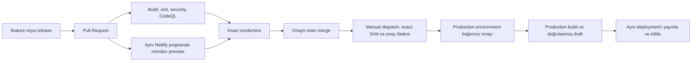

# GitHub ve Netlify kalıcı mimarisi

9 Kasım 2026 — yetkili salt okunur API kontrolüne göre.

## Tek kaynak ve gerçek mevcut durum

Kalıcı kaynak **umutgecer01/karaoglugroup**. Eski **umutgecer01/karaoglu-group-website** deposu korunuyor; ana production projesi artık eski depoya bağlı değil. Eski deponun başka hizmetlerle ilişkisi bu tespitten çıkarılamaz.

| Bileşen | Doğrulanan durum |
| --- | --- |
| GitHub main | `47ba0c370e8f291faff198f895c503547b95b65f`, ilk yükleme; güncel uygulamayı içermiyor |
| Bu çalışmanın başlangıç release HEAD'i | `d4287c5f4278369f6b7548b9c1d3ca387d7ba006` |
| Canlı uygulama kaynağı | `6ca07f9aefcf84cc1ae56ecbabc0f19fd1b6a5f5`; sonraki başlangıç commit'leri yalnızca yayın belgeleri |
| Canlı deployment | `6af18e98278ff0906ad9ca6a`, ready, published, locked |
| Eski kaynak `c45a5c0` | Güncel canlı temelinden daha eski; yalnızca tarihsel referans |
| Ana Netlify projesi | `karaoglugroupnet`, `b4753086-eb94-4a7e-b5f5-7270835fab3a` |
| Ana proje Git bağlantısı | `umutgecer01/karaoglugroup` → `main`; `npm run build` / `dist`; Node 22 |
| Git build / yayın kilidi | `stop_builds=false`; otomatik PR preview açık, canlı yayın kilitli |
| Korunan ikincil proje | `karaoglugroup`, `80b58d06-0cbb-432c-8193-17d34ba776df`; aynı depoya bağlı, base production yok |

ZIP içindeki workflow ve KURULUM.md yalnızca taslak referans olarak incelendi; eski repo bağlantısı ve durmuş Git build varsayımları güncel olmadığı için dosyalar körlemesine kopyalanmadı. Ana projedeki açık Git build'leri kapatmak preview entegrasyonunu bozardı; bu değişiklik yapılmadı.

## İstenen branch düzeni

- `feature/*`: günlük geliştirme; CI push'ta ve main'e açılan PR'da çalışır.
- `release/*`: yayın adayı; mevcut release `release/karaoglu-final-2026-11-08`, draft PR #1.
- `main`: gelecekte yalnızca onaylanmış, kontrol edilmiş kaynak. Şimdiki main eski olduğu için yayınlanabilir sayılmaz; bu çalışma main'e merge/push yapmaz.

## Tek production kanalı

Şu anda çalışan yayın yöntemi yetkili operatörün ayrıca onaylanmış CLI/API işlemidir. Mevcut canlı yayın kilidi korunur. Netlify Git integration build/preview üretebilir; kilitli canlı yayını otomatik değiştiremez.

Yeni `.github/workflows/netlify-deploy.yml` **manuel ve teknik olarak hazır bir gelecek kanalıdır**. Henüz main'e alınmadı, production environment ve token kurulmadı, gerçek workflow/deployment denenmedi. Bu nedenle aktif bir Actions production otomasyonu olduğu iddia edilmez.

Bu kanala geçiş onaylanırsa tek normal production yolu bu workflow olur; CLI yalnızca ayrı onaylanmış acil operasyon olarak kullanılır ve aynı anda çalıştırılmaz. Workflow `cancel-in-progress=false` ile production çalışmalarını sıraya koyar. CLI ile Actions arasında ortak sunucu kilidi olduğu iddia edilmez; exact baseline kontrolü ve operasyon koordinasyonu gerekir.

Main'e merge onayı, production yayın onayı yerine geçmez. Production workflow push ile çalışmaz. Netlify Git build'leri açık kalır; **yayın kilidi kaldırılmaz**. Onaylı paket önce draft yüklenir, doğrulanır ve yalnızca o deployment yayınlanıp kilitlenir. Önizleme build'i noindex olduğu için production paketi olarak yeniden kullanılmaz; aynı Git tree ayrı production context ile derlenir.

## GitHub güvenlik ayarları ve mevcut eksikler

Yetkili GitHub hesabı admin/maintain/push yetkili, depo public. Main branch protection API 404, ruleset listesi boş; environment listesi ve repository secret listesi boş. Production environment/secret endpoint'leri 404. Salt okunur denetimde bu ayarlar oluşturulmadı.

Netlify bağlantısı GitHub App kullanır; repository webhook listesi boş olması bağlantının yokluğu anlamına gelmez. Netlify tarafında dokuz GitHub App build/status/check/review hook'u ve çalışan PR preview doğrulandı. Bunlar form e-postası bildirimleri değildir.

GitHub public depolarda gerekli incelemeler ve environment korumaları desteklenebilir; bu depoda fiilen kurulu olan ayarlar API ile ayrıca denetlenmelidir. [Branch koruması](https://docs.github.com/en/repositories/configuring-branches-and-merges-in-your-repository/managing-protected-branches/about-protected-branches), [environment korumaları](https://docs.github.com/en/actions/reference/workflows-and-actions/deployments-and-environments).

Kurulacak main koruması: PR zorunluluğu, uygun bağımsız reviewer, build/security/CodeQL/aynı proje preview kontrol isimleri, force-push ve silme yasağı, yöneticilere de uygulanacak politika. Kontrol adları gerçek PR check listesine göre seçilmeli; yanlış isimli zorunlu kontrol merge'i süresiz bekletebilir. Reviewer seçimi/yönetici istisnaları şirketin yetkili kişisiyle kararlaştırılmadan bu ayarlar uzaktan yazılmadı. Ayrıntı: [DEPLOYMENT_GUIDE.md](DEPLOYMENT_GUIDE.md).

GitHub secret değerleri API ile geri okunamaz. Listede secret bulunmadığından doğrulanmış bir GitHub production token'ı yok. Yerel resmî Netlify oturumu iki projeyi okuyabiliyor; bu, gelecekte eklenecek GitHub secret'ın erişimini kanıtlamaz. Workflow token'ı yalnızca yayın adımının ortamında alır ve gerçek doğru Project ID/URL'yi API üzerinden denetler.

## Kayıt, yedek ve yetki

Başlangıç Git geçmişi `.audit/operations-baseline-d4287c5-20261109.bundle` ile yerelde yedeklendi. Mevcut production paketi SHA256 manifest'iyle `.audit/production-release-6ca07f9-2026-11-09/` altında korunuyor. Bunlar credentials içermez ve Git'e gönderilmez. Eski çalışan deployment da Netlify API'de ready olarak doğrulandı.

Tamamlanan geliştirmeler mevcut izinle release dalına normal push edilir ve aynı projede preview doğrulanır. Main merge/push, production yayını/rollback, secrets, repo bağlantısı, Git build ayarı, form aktivasyonu ve gerçek gönderim için ilgili ayrı açık onay gerekir. Bu incelemede canlı deployment korunur.
